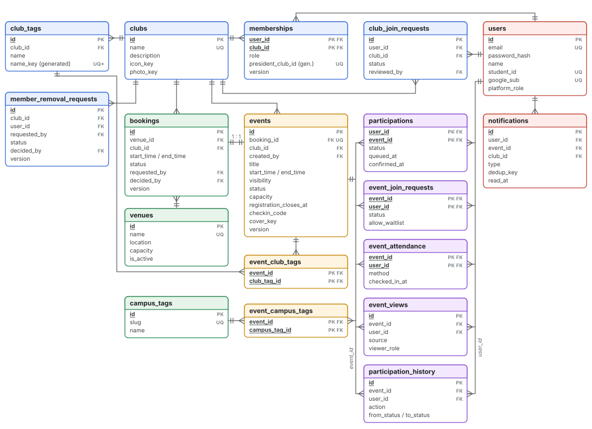

# ClubSpace Architecture

This file summarises the final architecture. The full write-up, including the
API reference, workflows and screenshots, is in
[`ClubSpace-Final-Documentation-Group19.pdf`](ClubSpace-Final-Documentation-Group19.pdf).

## 1. Deployment

Six Docker Compose services ([`compose.yaml`](compose.yaml)) run on the Group 19
VM `c3322-pg19.cs.hku.hk`. Only nginx is reachable from outside, and MySQL's port
3306 is not published.

```text
Browser ──HTTPS :443──▶ web (nginx: built React SPA, proxies /api/; :80 redirects)
                           │
                           ▼
                      backend (Express 5, /api/v1, SSE stream) ──▶ db (MySQL 8.4, volume db_data)
                      worker  (reminders, digests, clean-up)    ──▶ db
                      migrate (one-shot: applies schema migrations)
                      seed    (one-shot: demo data on an empty database)
```

- **web**: nginx serves the built SPA over HTTPS (self-signed certificate on
  the `web_certs` volume) and proxies `/api/` to the backend.
- **backend**: the REST API under `/api/v1`. It keeps sessions in MySQL, checks
  CSRF tokens and `Origin`, rate-limits logins, accepts event cover and club icon uploads (stored on
  the `cover_data` volume) and streams live updates with Server-Sent Events.
- **worker**: claims jobs from the `notification_jobs` outbox (written in the
  same transaction as each change) and sends reminders and daily club digests,
  with retries and a heartbeat.
- **migrate** and **seed**: one-shot jobs that apply ordered, checksummed
  migrations and load demo data into an empty database.

## 2. Backend layers

| Layer | Responsibility |
| --- | --- |
| Middleware (`src/middleware`) | Request ID, JSON body limit, CSRF and origin checks, and one error handler producing `{ error: { code, message, fields, request_id } }` |
| Routers (`src/api_v1`) | One router per area: auth, clubs, events, registration, engagement, reports, covers, club icons, notifications, Google sign-in |
| Transactions and queries | Business rules run in MySQL transactions with a fixed lock order (venue → club → bookings → event → participations) |
| Jobs and live delivery (`src/jobs`, `src/features/notifications`) | Durable job queue with lease tokens; an SSE hub that follows the `notifications` and `live_signals` tables |

## 3. Entity-relationship diagram

The 17 domain tables of the final schema ([`backend-beta/db/schema.sql`](backend-beta/db/schema.sql)
plus [`backend-beta/db/migrations/`](backend-beta/db/migrations/) up to
`019_club_icons`). It was generated from the migrated database by
[`docs/final-report/er-diagram.mjs`](docs/final-report/er-diagram.mjs).



Infrastructure tables not drawn above: `notification_jobs` (outbox and job
queue), `live_signals` (SSE change hints), `sessions`, `audit_logs`,
`club_action_log`, `activity_digests`, `worker_heartbeats`,
`schema_migrations` and `schema_metadata`.

## 4. Integrity rules in MySQL

- **One president per club:** a generated `president_club_id` column with a
  unique index.
- **No double booking:** overlapping confirmed bookings are rejected inside the
  approval transaction, which locks the venue and the overlapping bookings.
- **Check constraints:** time order, event capacity between 1 and 500, and the
  registration deadline before the start.
- **Idempotency keys:** on jobs, notifications, audit entries and event views.

## 5. API

The SPA uses only `/api/v1`. See the [API section of the README](README.md#api),
section 6 of the final documentation, and the full contract in
[`openspec/changes/expand-clubspace-workflows/handoff/api.md`](openspec/changes/expand-clubspace-workflows/handoff/api.md).
