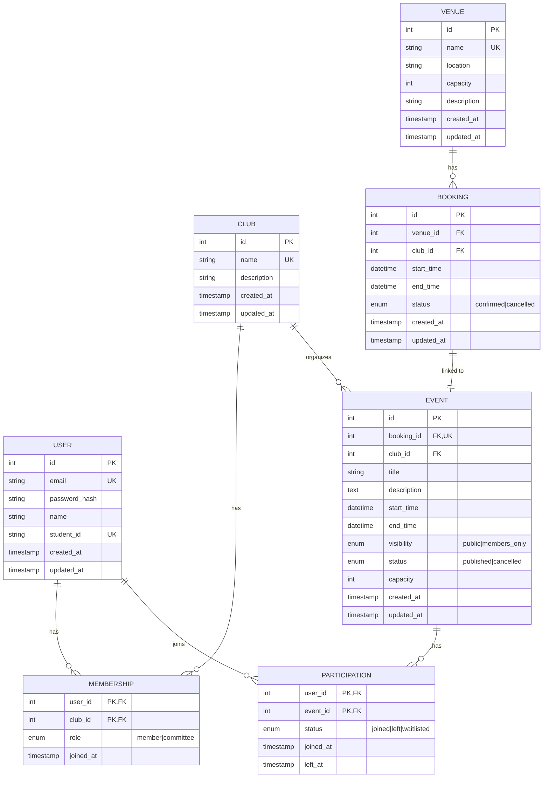

# ClubSpace Architecture

## 1. Entity-Relationship Diagram

## 2. Club and Membership API

Until session authentication is implemented, membership endpoints operate on
the demo user configured by `DEMO_USER_ID`.

| Method | Route | Purpose |
| --- | --- | --- |
| `GET` | `/api/clubs` | List clubs with the current user's membership status and role |
| `GET` | `/api/memberships` | List the current user's club memberships |
| `POST` | `/api/clubs/:club_id/membership` | Join a club |
| `DELETE` | `/api/clubs/:club_id/membership` | Leave a club |

Joining an unknown club returns `404`; joining a club twice returns `409`.
Leaving a club the user has not joined also returns `409`. Invalid club IDs
return `422`.

## 3. Event Participation API

Until session authentication is implemented, event participation endpoints
operate on the demo user configured by `DEMO_USER_ID`.

| Method | Route | Purpose |
| --- | --- | --- |
| `POST` | `/api/events/:event_id/participation` | Join a published event |
| `DELETE` | `/api/events/:event_id/participation` | Leave an event |

`GET /api/events` includes `is_joined` for the demo user and a `joined_count`
for each event. Joining a members-only event requires membership in its
organizing club; leaving that club later does not remove the event
participation. Rejoining after leaving reactivates the existing participation
record. Unknown event IDs return `404`, membership restrictions return `403`,
and duplicate joins or attempts to leave an event not joined return `409`.
